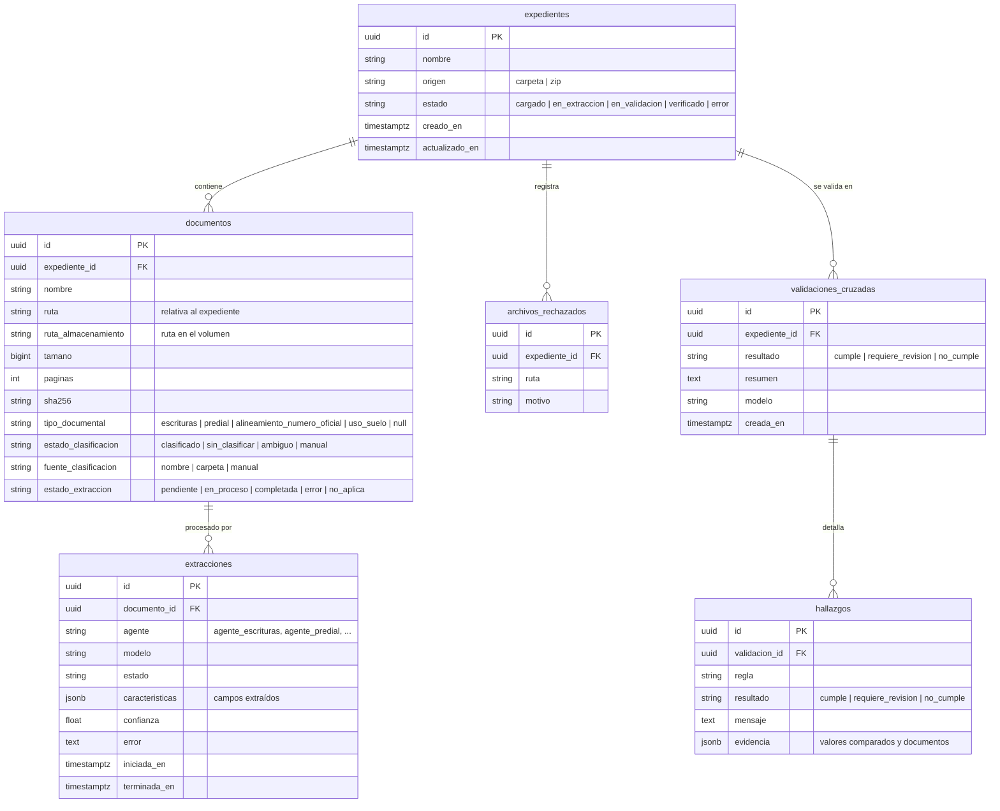

# Base de datos

PostgreSQL 17 (servicio `db` en docker-compose), SQLAlchemy 2 y migraciones con Alembic.
Los PDF **no** se guardan en la BD: viven en el volumen `expedientes_data`
(`/data/expedientes/<expediente_id>/documentos/...`); la BD guarda metadatos, clasificación y resultados.

Modelos: [`backend/app/db/models.py`](../backend/app/db/models.py)

## Flujo y tablas

```
carga + validación ─► clasificación ─► extracción (agentes especialistas) ─► validación cruzada (orquestador) ─► verificación
   expedientes           documentos          extracciones                       validaciones_cruzadas + hallazgos
   archivos_rechazados
```



## Decisiones

- **Enums como `VARCHAR`** (no `ENUM` nativo de Postgres): agregar un tipo documental o un estado no requiere migración de tipos.
- **`extracciones.caracteristicas` en JSONB**: cada agente devuelve campos distintos (folio, propietario, superficie, clave catastral, adeudo, uso permitido...). Se pueden consultar con operadores JSONB y, cuando los campos se estabilicen, validar con un esquema Pydantic por tipo.
- **Una fila por intento de extracción**: si un agente falla y se reintenta, queda el historial; la vigente es la última `completada`.
- **Documentos sin clasificar** quedan con `estado_extraccion = no_aplica` y no se envían a ningún agente hasta que se les asigne un tipo (`PATCH /api/documentos/{id}`).
- **`sha256`** permite detectar el mismo PDF subido dos veces o reutilizar extracciones.
- **Validación cruzada versionada**: cada corrida del orquestador crea una fila nueva en `validaciones_cruzadas` con sus `hallazgos`; la verificación que se muestra es la más reciente.

## Siguiente paso (agentes)

1. `documentos_para_agentes(db, expediente_id)` (en `app/services/expedientes.py`) ya agrupa por agente los documentos `pendiente`.
2. Cada agente especialista crea una `Extraccion` (`en_proceso`), procesa `ruta_almacenamiento` y la cierra con `caracteristicas` o `error`; actualiza `documentos.estado_extraccion`.
3. Cuando no queden documentos `pendiente`/`en_proceso`, el expediente pasa a `en_validacion` y el orquestador lee las extracciones vigentes, escribe `validaciones_cruzadas` + `hallazgos` y deja el expediente en `verificado`.

## Migraciones

```powershell
# Crear una migración tras cambiar models.py
docker compose exec backend alembic revision --autogenerate -m "descripcion"
```
```powershell
# Aplicarlas (también se aplican solas al arrancar el backend)
docker compose exec backend alembic upgrade head
```
```powershell
# Consola SQL
docker compose exec db psql -U expedientes
```
